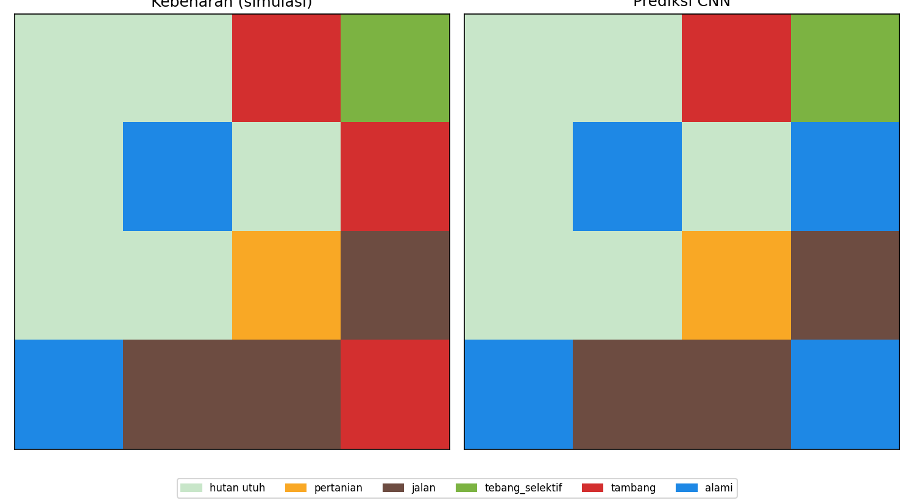
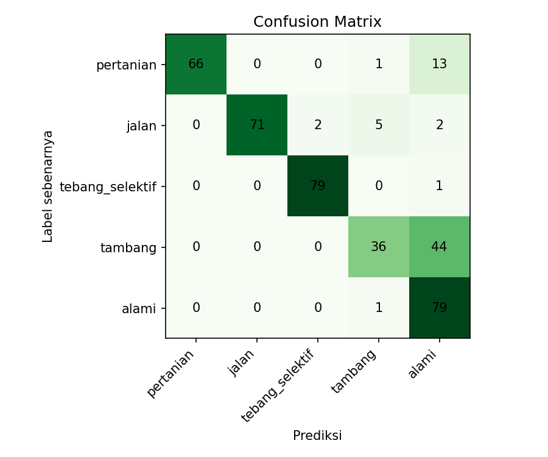
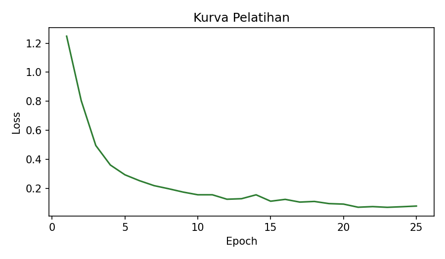

<div align="center">

# 🌳 Forest Cause CNN

**Klasifikasi Penyebab Gangguan Hutan dari Citra Satelit Sintetis (Sentinel-1 + Sentinel-2) Menggunakan CNN**


</div>

---

## 📖 Latar Belakang

Hutan tropis menyimpan karbon, mengatur siklus air, dan menjaga keanekaragaman hayati. Sistem *deforestation alerts* mampu mendeteksi **di mana** hutan terganggu, tetapi pengambil keputusan juga perlu tahu **apa penyebabnya**: pertanian, jalan, penebangan selektif, tambang, atau gangguan alami.

Proyek ini adalah studi kasus mini berdasarkan **Sesi 6: Pemantauan Deforestasi Menggunakan Citra Satelit dan AI** (Dr. Bart Slachter, Wageningen University and Research). Fokusnya: tahap *klasifikasi penyebab gangguan* menggunakan CNN.

## 🎯 Rumusan Masalah

1. Dapatkah CNN kecil membedakan lima penyebab gangguan hutan dari kombinasi data optik dan radar?
2. Seberapa besar awan menurunkan akurasi, dan seberapa jauh radar membantu?
3. Kelas mana yang paling sering salah diklasifikasikan?

## 🧭 Batasan Masalah

| Aspek | Batasan |
|---|---|
| Data | **Sintetis**, dibangkitkan dengan kode. Bukan citra Sentinel asli |
| Input | Patch 32×32 piksel, 4 kanal |
| Kelas | pertanian, jalan, tebang_selektif, tambang, alami |
| Deteksi | Deteksi gangguan disederhanakan: penurunan NDVI melewati ambang |
| Model | CNN 3 lapis konvolusi, dilatih dari nol |
| Di luar cakupan | Kalibrasi radiometrik, georeferensi, data waktu (time series) nyata, validasi lapangan |

> ⚠️ Angka akurasi hanya berlaku pada data simulasi dan **tidak boleh** dianggap performa di dunia nyata.

## 🛰️ Desain Data Sintetis

Setiap patch memiliki 4 kanal yang meniru Sentinel-2 dan Sentinel-1:

| Kanal | Sumber | Makna |
|---|---|---|
| 0 | Sentinel-2 | NDVI sebelum gangguan |
| 1 | Sentinel-2 | NDVI sesudah gangguan |
| 2 | Sentinel-1 | Backscatter VV sesudah gangguan |
| 3 | Sentinel-1 | Backscatter VH sesudah gangguan |

Ciri tiap kelas yang disimulasikan:

| Kelas | Bentuk area | Catatan konteks |
|---|---|---|
| pertanian | Persegi panjang besar | Kadang ada jalan akses di sekitarnya |
| jalan | Garis tipis memanjang | Bentuk sempit dan panjang |
| tebang_selektif | Bintik kecil tersebar | Banyak titik kecil |
| tambang | Blob tidak beraturan | Perubahan radar kuat, kadang ada jalan akses |
| alami | Blob tidak beraturan | Tumpang tindih dengan tambang (mirip kasus kebakaran vs banjir) |

Agar realistis, tiap sampel diberi **noise**, variasi kekuatan sinyal, dan **awan acak (30%)** yang menutupi kanal optik saja. Radar tidak terpengaruh awan, mengikuti materi pemateri.

## 🧠 Arsitektur Model

```
Input (4×32×32)
 → Conv(16) + BN + ReLU + MaxPool
 → Conv(32) + BN + ReLU + MaxPool
 → Conv(64) + BN + ReLU + GlobalAvgPool
 → Dropout(0.3) → Linear(5)
```

CNN menerima seluruh patch sehingga mempertimbangkan **bentuk, ukuran, dan lingkungan sekitar**, bukan nilai piksel tunggal.

## 📁 Struktur Proyek

```
forest-cause-cnn/
├── main.py
├── requirements.txt
├── src/
│   ├── config.py
│   ├── synthetic.py
│   ├── model.py
│   ├── train.py
│   ├── evaluate.py
│   └── alert_map.py
└── outputs/
    ├── alert_map.png
    ├── confusion_matrix.png
    ├── training_loss.png
    ├── report.txt
    ├── cloud_test.txt
    └── alert_map_accuracy.txt
```

## ▶️ Cara Menjalankan

```bash
pip install -r requirements.txt
python main.py
```

Seluruh hasil tersimpan di folder `outputs/` (berjalan di CPU, sekitar satu hingga dua menit).

## 📊 Hasil (seed 42)

| Metrik | Nilai |
|---|---|
| Akurasi uji | **82,8%** |
| Akurasi tanpa awan | 87,2% |
| Akurasi dengan awan | 76,8% |
| Akurasi peta alert (10 sel gangguan) | 80,0% |

Per kelas (F1): pertanian 0,90 · jalan 0,94 · tebang_selektif 0,98 · tambang 0,59 · alami 0,72

### Peta Alert


### Confusion Matrix


### Kurva Pelatihan


## 🔍 Analisis

- **Bentuk jelas mudah dikenali.** Penebangan selektif (bintik tersebar) dan jalan (garis) memiliki F1 tinggi.
- **Tambang vs alami adalah sumber kesalahan utama.** Keduanya berbentuk blob tidak beraturan dengan sinyal yang tumpang tindih. Ini sejalan dengan materi: gangguan alami sering sulit dibedakan dari gangguan lain, seperti kebakaran dengan banjir.
- **Awan menurunkan akurasi sekitar 10 poin.** Kanal radar menjaga model tetap berfungsi, tetapi informasi optik yang hilang tetap mengurangi performa.
- **Data lapangan tetap diperlukan.** Pada kasus ambigu, citra saja tidak cukup.

## 🚀 Pengembangan Lanjutan

- Mengganti data sintetis dengan patch Sentinel-1/2 asli dan label dari data deforestasi publik.
- Menambah kelas kebakaran dan banjir secara terpisah.
- Menambahkan deret waktu dan konteks patch yang lebih luas.
- Menambah data latih khusus untuk kelas yang sering salah.

## 🙏 Referensi

Materi Sesi 6: *Pemantauan Deforestasi Menggunakan Citra Satelit dan Artificial Intelligence*, Dr. Bart Slachter, Wageningen University and Research.

---

<div align="center">

Yovanza Villareal - G1A023054

</div>
